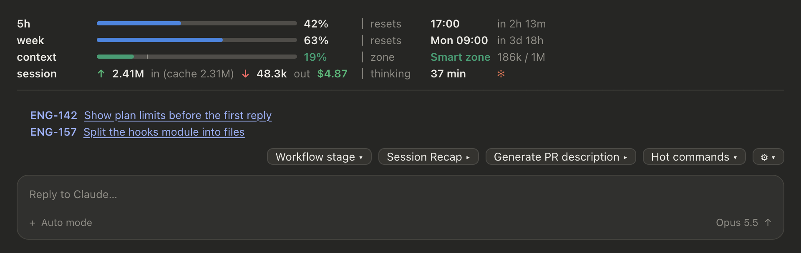
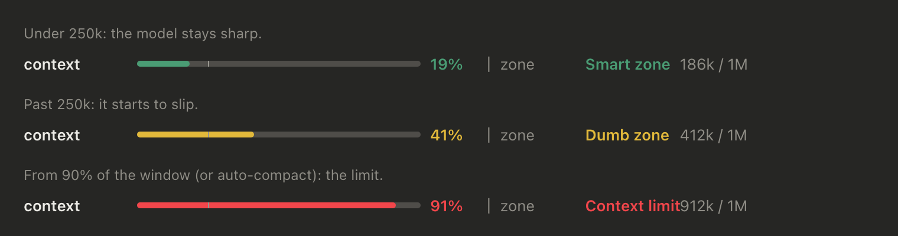
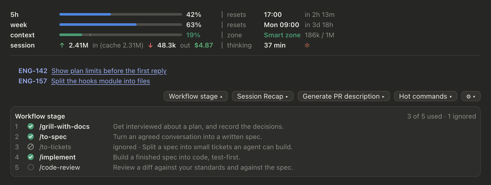
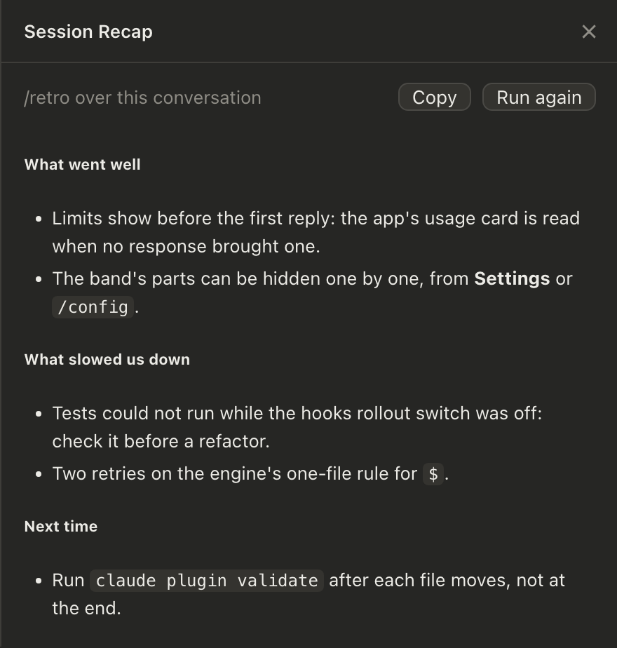
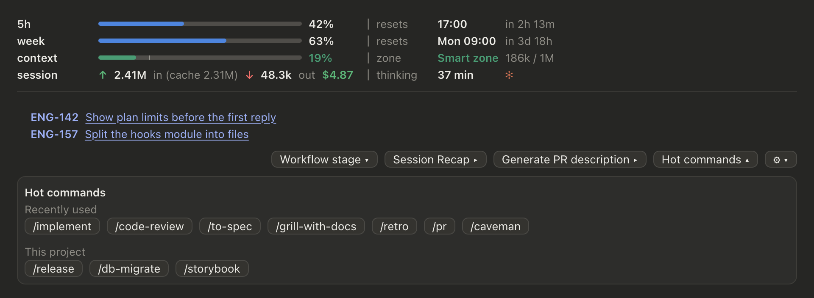
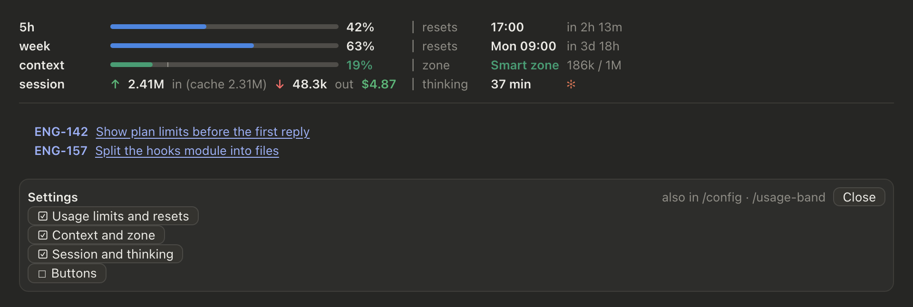
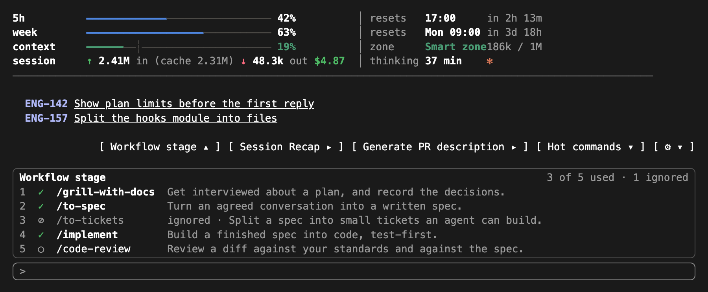

# Claude usage band plugin

A Claude Code plugin that puts a band above the prompt. The band shows how much of your plan you have used and when it resets. It shows how full the context window is, and whether the model is still in its smart zone. It shows what the session cost, how long Claude has been thinking, and the Linear tasks you are working on. Below that is a row of buttons for your workflow: Workflow stage, Session Recap, Generate PR description and Hot commands.



<sub>The screenshots draw the plugin's own view code with sample data.</sub>

## Contents

- [What the band shows](#what-the-band-shows)
  - [Usage limits and resets](#usage-limits-and-resets)
  - [Context and zone](#context-and-zone)
  - [Session and thinking](#session-and-thinking)
  - [Linked Linear tasks](#linked-linear-tasks)
- [Buttons](#buttons)
  - [Workflow stage](#workflow-stage)
  - [Session Recap](#session-recap)
  - [Generate PR description](#generate-pr-description)
  - [Hot commands](#hot-commands)
- [Settings](#settings)
- [In the terminal](#in-the-terminal)
- [Requirements](#requirements)
- [Install](#install)
- [What it reads, calls and stores](#what-it-reads-calls-and-stores)
- [Development](#development)
- [License](#license)

## What the band shows

The band has two columns. The left column holds a bar and a percentage for each row. The right column holds the matching resets, zone and thinking time, aligned row by row.

### Usage limits and resets

| Row | Meaning |
| --- | --- |
| `5h` | The rolling 5-hour limit. |
| `week` | The weekly limit, all models. |
| `week opus`, `week sonnet` | Per-model weekly limits, when your plan has them. |
| `spend $` | The spend limit, when there is one. |

- **Bar:** in the blue of Claude Code's own context bar. The unused part is drawn a few tones lighter, so it shows on a dark background.
- **Percentage:** white below 70%, yellow from 70% and red from 90%.
- **resets:** the local time a window resets (`17:00` today, `Mon 09:00` on another day), with a countdown (`in 2h 13m`, `in 3d 18h`).

The limits come from three places, in this order:

1. **Each model response.** Its rate-limit headers are read again 1.5 s after the response, at no cost in tokens.
2. **The desktop app's own usage card.** This is the `get_usage` tool, the same reading the app's usage panel shows. It makes no model call. The plugin reads it when no response has brought a reading for a minute. That covers a new session before its first message, and an idle session while other sessions use the plan.
3. **The last reading any session kept.** A window whose reset has passed shows as 0% until a fresh reading comes in.

So the bars are there as soon as a session opens, without waiting for the first reply.

### Context and zone

The context row shows how full the context window is. The bar is colored by **zone**, with a tick at 250k on windows bigger than that. The right column names the zone and shows the token count (`186k / 1M`).



| Zone | When | Color |
| --- | --- | --- |
| **Smart zone** | Under 250k tokens: the model stays sharp. | green |
| **Dumb zone** | From 250k: it starts to forget instructions, make mistakes and invent things. | yellow |
| **Context limit** | From 90% of the window, or from the auto-compact point if that comes first. | red |

The 250k border is a rule of thumb, not a hard limit. It is `SMART_MAX` in [`hooks/theme.ts`](hooks/theme.ts).

### Session and thinking

- **↑ in:** the session's input tokens, cache reads and writes included. The cache-read share is shown in brackets.
- **↓ out:** the output tokens.
- **$:** the session's cost, as Claude Code reports it.
- **thinking ✻:** the time Claude spent on this session's turns. Each main-thread turn is measured from your prompt to Claude's last message.

Tokens count up live while a turn runs, one response at a time, and the thinking time ticks while the turn is running. A resumed session picks up its totals. A session older than the plugin gets its thinking time from its transcript.

### Linked Linear tasks

Paste a Linear issue link (`https://linear.app/<workspace>/issue/ENG-142/...`) into a prompt. The band then lists that issue as its ID plus a link to it.

- **Title:** taken from the link's slug at first. If a Linear MCP server is connected and its permissions allow the call without a dialog, the plugin asks it for the exact title. A title a Linear tool already returned in the conversation is used too. Titles are cached across sessions.
- **Session title (desktop app):** prefixed with the IDs, for example `ENG-142, ENG-157 | Show plan limits`. In the terminal, the session title gets the same prefix through the classic hooks.

## Buttons



### Workflow stage

The **Workflow stage ▾** button opens a checklist of a task's five stages, each one a skill:

| # | Skill | Stage |
| --- | --- | --- |
| 1 | `/grill-with-docs` | Get interviewed about a plan, and record the decisions. Also counts `grill-me` and `grilling`. |
| 2 | `/to-spec` | Turn an agreed conversation into a written spec. |
| 3 | `/to-tickets` | Split a spec into small tickets an agent can build. |
| 4 | `/implement` | Build a finished spec into code, test-first. |
| 5 | `/code-review` | Review a diff against your standards and against the spec. |

Each stage has a status:

- ✓ **done:** its skill ran in this conversation.
- ⊘ **ignored:** it did not run, but a later stage did.
- ○ **not reached:** neither.

Stages are found from Skill tool calls and from slash commands you type. That includes a command on its own line below other text, and plugin-prefixed names such as `mattpocock-skills:to-spec`. A compaction does not forget a stage that already ran. To change the stages, edit `STAGES` in [`hooks/stages.ts`](hooks/stages.ts).

### Session Recap

**Session Recap ▸** runs your `/retro` skill over the conversation and shows the answer in a sidebar pane.

- The run is a background fork that reads the conversation from the prompt cache. Nothing is added to your conversation.
- While it works, the button shows `Session Recap ✻`.
- Press the button again to close the pane. Opening it again shows the last answer.
- The pane has **Copy** and **Run again**.
- If the skill tells the model to load other skills, those skills are inlined into the run.



The `retro` skill is read from `.claude/skills/retro/SKILL.md`: the project's copy first, then your own in `~/.claude/skills`.

### Generate PR description

**Generate PR description ▸** runs your `/pr` skill over the branch's changes. The answer is a PR body, ready to paste, in a sidebar pane with **Copy** and **Run again**.

The run gets, from git:

- **Base branch:** `origin/HEAD`, else `origin/main`, `origin/master`, `main` or `master`.
- **Commits** since the merge base.
- **`git status`** and **the diff stat**.
- **The diff:** lockfiles, minified files, source maps, snapshots and `dist/` and `build/` are left out. Each file is cut to fit a 60k-character budget, and the most-changed files are kept.
- **`GLOSSARY.md`**, if the repository has one.

If the conversation's prompt cache is still warm (last turn under 50 minutes ago), the run forks over the conversation as well. Otherwise it goes without the conversation, so the whole conversation is not billed again.

### Hot commands

**Hot commands ▾** lists the skills you use, as buttons. A press puts `/name ` at the start of the prompt.

- **Recently used:** up to 12 skills you ran, newest first. They are taken from this session and, the first time, from your recent transcripts.
- **This project:** the skills in `.claude/skills` of the project folder and each folder above it, up to your home folder.



## Settings

Each part of the band can be shown or hidden:

| Option | Shows |
| --- | --- |
| **Usage limits and resets** (`showLimits`) | The 5h and weekly limit bars, with when each resets. |
| **Context and zone** (`showContext`) | The context window bar and its zone. |
| **Session and thinking** (`showSession`) | Tokens in and out, cost and thinking time. |
| **Buttons** (`showButtons`) | Workflow stage, Session Recap, Generate PR description and Hot commands. |

There are three ways to change them:

- the **⚙** button at the end of the buttons row;
- `/usage-band`, which opens and closes the same panel, so it still works after the buttons are hidden;
- `/config`, where they are listed under the plugin.



The choices are the plugin's options, kept in `settings.json` under `pluginConfigs["usage-band"].options`. A change reloads the plugin with the new values. If no settings row can take a change (for example, a managed setting is locked), the choice is kept in the plugin's own store instead.

If you hide every part and no task is linked, the band steps aside completely. `/usage-band` brings the Settings panel back.

## In the terminal

The terminal cannot draw images, so the band uses glyphs instead:

- `━` for the used part of a bar and `─` for the rest;
- `┆` for the 250k tick;
- `✓ ⊘ ○` for the stages;
- `[ label ]` for buttons.



The desktop app's usage card is not available in the terminal. Limits there come from responses, and before the first response they come from the last kept reading.

## Requirements

- **Claude Code with plugin hooks modules** (function hooks: `hooks/hooks.json` with `"modules"`). The plugin is developed against Claude Code 2.1.295, the build in the desktop app's Code tab.
- **Optional:**
  - the **desktop app (Code tab)**, for limits before the first response and for the session-title prefix;
  - a **Linear MCP server**, for exact task titles;
  - **`retro` and `pr` skills**, for Session Recap and PR description;
  - the **stage skills**, for the Workflow stage panel to fill in.

## Install

From GitHub, inside Claude Code:

```
/plugin marketplace add DenisRupp/Claude-usage-band-mod
/plugin install usage-band@usage-band
/reload-plugins
```

Or from a shell:

```bash
claude plugin marketplace add DenisRupp/Claude-usage-band-mod
```

```bash
claude plugin install usage-band@usage-band
```

From a local clone, for development: the installed plugin then reads straight from the folder.

```bash
git clone git@github.com:DenisRupp/Claude-usage-band-mod.git
```

```bash
claude plugin marketplace add ./Claude-usage-band-mod
```

```bash
claude plugin install usage-band@usage-band
```

To update:

```bash
claude plugin marketplace update usage-band
```

```bash
claude plugin update usage-band@usage-band
```

## What it reads, calls and stores

The plugin runs inside Claude Code's plugin engine and makes no network requests of its own.

**Reads**

- The session's usage figures: tokens, cost, rate limits and context.
- Transcripts in `~/.claude/projects`: this session's, for thinking time, and up to 25 recent ones (4 MB at most), once, for Hot commands.
- `SKILL.md` files, in the project and in `~/.claude/skills`.
- The repository's `GLOSSARY.md`.

**Runs** read-only git commands (`rev-parse`, `symbolic-ref`, `merge-base`, `log`, `status`, `diff`), and only when you press **Generate PR description**.

**Calls tools on its own**

- the desktop app's `get_usage`, `get_session` and `set_session_title`;
- your Linear server's `get_issue`.

It does this only when your permission settings allow the call outright, or when the session is in auto or bypass mode. It never puts a permission dialog in front of you.

**Model calls** happen only when you press **Session Recap** or **Generate PR description**. They are billed like any other call, and their tokens are added to the session's count.

**Stores** in the plugin's own store:

- each session's totals, stages and tasks, for the last 40 sessions;
- the last limits reading;
- Linear titles;
- recently used skills;
- the Settings fallback.

## Development

```
.claude-plugin/
  plugin.json        manifest and the four userConfig options
  marketplace.json   a one-plugin marketplace, so the repo installs as is
hooks/
  hooks.json         { "modules": ["./register.tsx"] }
  register.tsx       every hook and every call on the engine ($), the state atoms
  band.tsx           the band's view: rows, tasks, buttons, panels (pure)
  runs.tsx           Session Recap / PR runs: prompts, diff cutting, the pane's view
  draw.tsx           SVG bars and icons, terminal glyph bars, row layouts
  theme.ts           colors, sizes, labels, the context zones
  format.ts          token, cost and time formatting
  usage.ts           limit readings: the app's usage card, the kept reading
  linear.ts          Linear links, titles, the session-title prefix
  stages.ts          the workflow stages and how a conversation's are found
  skills.ts          Hot commands: transcript scan, SKILL.md parsing
  settings.ts        which parts are shown
  thinking.ts        turn time from a transcript
types/index.d.ts     the $.state contract (PluginState)
test/usage-band.test.tsx
```

The engine sets some rules for a hooks module, and the file split follows them:

- There is one hooks module per plugin.
- `$` can only be passed to functions in the same file.
- An atom must be created in the file that reads it.
- A pane matcher's `requestId` must be a literal or a const in the same file.

So everything that touches the engine lives in `register.tsx`, and every other file is pure. A closure made in `register.tsx` may be handed to a pure view, as the band's button actions are.

Check, test and type-check:

```bash
CLAUDE_CODE_ENABLE_FUNCTION_HOOKS=1 claude plugin validate .
```

```bash
CLAUDE_CODE_ENABLE_FUNCTION_HOOKS=1 claude plugin test .
```

```bash
npx tsc -p .
```

`tsconfig.json` extends `.claude-plugin/types/tsconfig.json`. The engine writes that file, with the API types, when it loads the plugin. It is git-ignored.

## License

[Apache 2.0](LICENSE)
